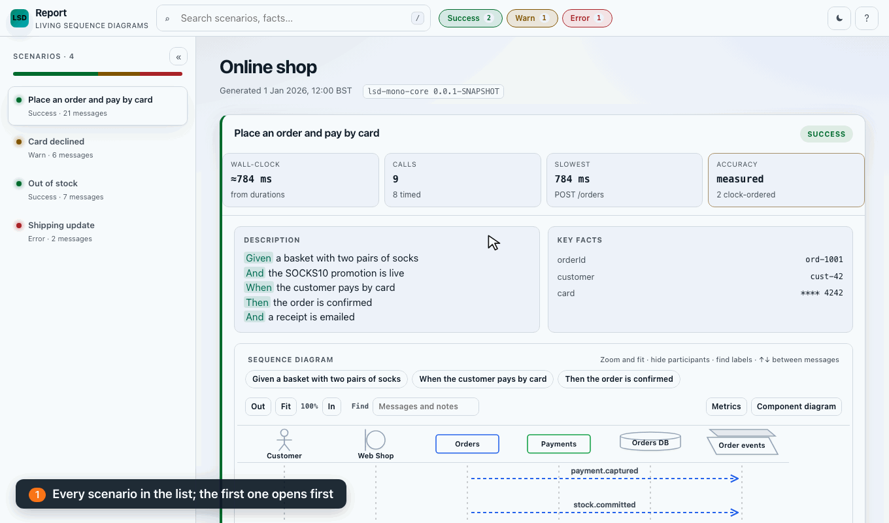

# LSD Mono

[](https://central.sonatype.com/artifact/io.github.lsd-consulting/lsd-mono-core)
[](https://github.com/lsd-consulting/lsd-mono/actions/workflows/gradle.yml)
[](https://www.jsdelivr.com/package/gh/lsd-consulting/lsd-mono)

LSD Mono records a scenario as a sequence of messages and writes an interactive HTML report. [`lsd-mono-core`](modules/lsd-mono-core) is the capture API and the report UI.



**[Live example report →](https://lsd-consulting.github.io/lsd-mono/example-report.html)** An online shop checkout across 14 services and five scenarios, built from the latest release. Click an arrow to see its request, reply or event payload.

[`lsd-mono-cucumber-8` README](modules/lsd-mono-cucumber-8/README.md) covers the Cucumber 8 plugin.

[`lsd-mono-junit-jupiter` README](modules/lsd-mono-junit-jupiter/README.md) covers the JUnit Jupiter 6 extension that completes a scenario for each test.

[`lsd-mono-coroutines` README](modules/lsd-mono-coroutines/README.md) covers keeping a scenario bound while a coroutine moves between threads.

The source is at https://github.com/lsd-consulting/lsd-mono.

## Getting started

The artifacts are on Maven Central under `io.github.lsd-consulting`, all four on one version. Releases are automatic, so the snippets below say `X.Y.Z` instead of a version: use the latest, which the Maven Central badge above shows. The [release notes](https://github.com/lsd-consulting/lsd-mono/releases) say what changed in each. Until v1 they are `0.y.z`, and a minor release may change the API ([docs/releasing.md](docs/releasing.md)). They run on Java 17 or later.

| Artifact | Use it for |
| --- | --- |
| `lsd-mono-core` | The capture API (`LsdContext`) and the HTML report. Always needed. |
| `lsd-mono-junit-jupiter` | A scenario per JUnit Jupiter 6 test ([README](modules/lsd-mono-junit-jupiter/README.md)). |
| `lsd-mono-cucumber-8` | A scenario per Cucumber 8 scenario ([README](modules/lsd-mono-cucumber-8/README.md)). |
| `lsd-mono-coroutines` | Captures from coroutines that change threads, with kotlinx.coroutines 1 ([README](modules/lsd-mono-coroutines/README.md)). |

Gradle (Kotlin DSL), with the integrations you use:

```kotlin
val lsdMonoVersion = "X.Y.Z" // the latest version: see the Maven Central badge above

dependencies {
    testImplementation("io.github.lsd-consulting:lsd-mono-core:$lsdMonoVersion")
    testImplementation("io.github.lsd-consulting:lsd-mono-junit-jupiter:$lsdMonoVersion")
    testImplementation("io.github.lsd-consulting:lsd-mono-cucumber-8:$lsdMonoVersion")
    testImplementation("io.github.lsd-consulting:lsd-mono-coroutines:$lsdMonoVersion")
}
```

Maven:

```xml
<properties>
    <!-- the latest version: see the Maven Central badge above -->
    <lsd-mono.version>X.Y.Z</lsd-mono.version>
</properties>

<dependencies>
    <dependency>
        <groupId>io.github.lsd-consulting</groupId>
        <artifactId>lsd-mono-core</artifactId>
        <version>${lsd-mono.version}</version>
        <scope>test</scope>
    </dependency>
    <dependency>
        <groupId>io.github.lsd-consulting</groupId>
        <artifactId>lsd-mono-junit-jupiter</artifactId>
        <version>${lsd-mono.version}</version>
        <scope>test</scope>
    </dependency>
    <!-- lsd-mono-cucumber-8 and lsd-mono-coroutines the same way -->
</dependencies>
```

Each integration brings in `lsd-mono-core`; listing core as well keeps the API you call directly declared. You still bring the test runtime: a JUnit Jupiter engine for `lsd-mono-junit-jupiter`, and Cucumber 8 (`cucumber-java8` and `cucumber-junit-platform-engine`) for `lsd-mono-cucumber-8`. The module READMEs show the setup for each.

### From this repository

Another project in this build depends on the modules directly:

```kotlin
dependencies {
    implementation(project(":modules:lsd-mono-core"))
    testImplementation(project(":modules:lsd-mono-junit-jupiter"))
    testImplementation(project(":modules:lsd-mono-cucumber-8"))
    testImplementation(project(":modules:lsd-mono-coroutines")) // only if tests capture from coroutines
}
```

They are compiled with `--release 17`, and CI tests on Java 17, 21 and 25. Cucumber support is major 8.

## Capture a scenario

```kotlin
import io.lsdconsulting.lsd.mono.core.LsdContext
import io.lsdconsulting.lsd.mono.core.domain.ParticipantType.ACTOR
import io.lsdconsulting.lsd.mono.core.domain.ParticipantType.DATABASE
import io.lsdconsulting.lsd.mono.core.domain.ParticipantType.PARTICIPANT
import io.lsdconsulting.lsd.mono.core.domain.ParticipantType.QUEUE

val lsd = LsdContext()
lsd.addParticipants(
    ACTOR.called("Customer"),
    PARTICIPANT.called("Checkout"),
    DATABASE.called("Orders"),
    QUEUE.called("Order events"),
)
lsd.addFact("orderId", "ord-1001")
lsd.capture {
    "Customer" calls "Checkout" label "POST /orders" data mapOf(
        "method" to "POST",
        "path" to "/orders",
        "status" to 201,
        "body" to mapOf("sku" to "SOCK-1", "qty" to 2),
    )
    activate("Checkout")
    "Checkout" calls "Orders" label "insert order"
    "Orders" repliesTo "Checkout" label "row saved"
    "Checkout" sends "Order events" label "order.placed" data mapOf(
        "orderId" to "ord-1001",
        "sku" to "SOCK-1",
    )
    "Checkout" repliesTo "Customer" label "201 Created"
    deactivate("Checkout")
}
lsd.completeScenario("Place an order", "Customer checks out two pairs of socks.")
val listing = lsd.completeReport("Place an order")
lsd.createIndex()
```

`completeReport` writes under `build/reports/lsd` (set `lsd.mono.report.outputDir` to move it). Open `Place-an-order-1153f62c-diagram.html`: the interactive diagram. `Place-an-order-1153f62c-report.json` holds the data. `completeReport` returns both as `ReportFiles` (`diagramHtml`, `reportJson`). The 8 characters are a hash of the title, so two titles that read the same as file names (`Place an order`, `Place-an-order`) never overwrite each other. `createIndex()` writes `index.html`: the same report app with every report in the directory in its sidebar (failed first), including ones written by other test JVMs or modules. A report's data loads when you open it, and `index.html#report=<file stem>` links to one report.

Click an arrow to open its JSON. `method`, `path`, and `status` stay on the arrow. Any other fields load from `Place-an-order-1153f62c-payloads.js` when the panel opens.

The participant type is the header shape. `ACTOR` is a person, `DATABASE` a cylinder, `QUEUE` stacked plates. `ENTITY` is a circle and `BOUNDARY` a circle with a bar. Anything else, including `PARTICIPANT`, is a rounded box. Sync responses and async messages draw an arrow head at the destination.

## From a JUnit test

See the [JUnit Jupiter module README](modules/lsd-mono-junit-jupiter/README.md) for the extension setup and capture example. It completes each test scenario and writes the report after the class.

## From a Cucumber scenario

See the [Cucumber 8 module README](modules/lsd-mono-cucumber-8/README.md) for plugin registration, step definitions, and the capture example. It completes each scenario and writes one report per feature when the run finishes.

## Parallel tests

Capture is thread-safe, and both integrations support parallel runs (JUnit's `junit.jupiter.execution.parallel.enabled`, Cucumber's `cucumber.execution.parallel.enabled`). Each test or scenario gets its own buffer, bound to the thread that runs it, so `LsdContext.instance.capture` in a test lands in that test. Each test class or feature gets its own report.

A thread that is not bound to a test, such as an HTTP server thread, captures into the running test when only one test is running. When several are running, LSD cannot tell which test the capture belongs to: it logs a warning and keeps the capture out of all of them. Carry the test onto threads you start with `LsdContext.instance.wrap(task)` or `lsd.currentScenario()?.bind()`. A coroutine that changes dispatcher thread drops a thread binding; use `withLsdScenario` from the [coroutines module](modules/lsd-mono-coroutines/README.md).

## Configuration

Every setting is a `lsd.mono.*` property, read from a system property, an environment variable
(`LSD_MONO_REPORT_OUTPUTDIR`), a JUnit configuration parameter, or `lsd-mono.properties` on the
classpath, in that order. The [configuration reference](modules/lsd-mono-core/README.md#configuration-reference)
lists each one with its default; a test keeps that table in step with the code.

## Usage ping

A report written by a release of lsd-mono (not a `-SNAPSHOT` build) counts towards jsDelivr's public hit count, the number on the jsDelivr badge above. When the report opens, the page requests one tiny file from jsDelivr, pinned to the version that wrote the report:

```text
https://cdn.jsdelivr.net/gh/lsd-consulting/lsd-mono@<version>/ping/<event>.txt
```

- **Events.** `report-open` when a report or the index page opens. `source-junit`, `source-cucumber` or `source-api` for the integration that wrote the report. `metrics-open` and `components-open` when the Metrics view or the component diagram is opened. Each event is one file under [`ping/`](ping) and is requested at most once per page load.
- **What is sent.** Only the request: the version and the event, in the path. There is no query string, cookie or referrer, and no report title, scenario data or ids. Like any request, it shows jsDelivr your IP address and browser User-Agent ([jsDelivr's privacy policy](https://www.jsdelivr.com/terms/privacy-policy)). We only read jsDelivr's public totals per file and version.
- **The report doesn't depend on it.** The request is never awaited and a failure is ignored, so a report opened offline, from `file://`, or behind a proxy or Content-Security-Policy that blocks jsDelivr works and looks the same.
- **Turn it off** with `lsd.mono.report.usagePing=false`, set like any other [property](#configuration) (for example `LSD_MONO_REPORT_USAGEPING=false`). The setting is written into the report, and `false` means the page makes no request at all.

Snapshot builds, the report UI's dev server and checks, and the sample reports this repository publishes never ping.

## What the report looks like

The tour at the top clicks around a small shop report: four scenarios with every status, six participants, payloads, and durations. [`FeatureTourSample.kt`](modules/lsd-mono-core/src/readme/kotlin/io/lsdconsulting/lsd/mono/core/readme/FeatureTourSample.kt) captures it. The [lsd-mono-core README](modules/lsd-mono-core/README.md#component-diagram) covers the **Component diagram** button.

The report shows one scenario at a time, chosen from the sidebar, and the choice is kept in the URL. Each scenario has:

- the sequence diagram, fitted to its panel, with zoom steps (− and +), the % readout to go back to the default view, an Overview of the whole width, [find](#find-in-the-diagram) and participant hiding. A diagram taller than the screen extends the page and scrolls with it; the toolbar and the participant header stay at the top while you scroll;
- a side panel for an arrow's JSON (payloads load when the panel opens; secret-looking keys are redacted when captured), the component diagram, and timing and metrics;
- a timing summary (wall-clock, calls, slowest call, accuracy) with swim lanes and a waterfall, when the scenario has timing.

The theme follows the operating system (dark, light, or more contrast) until you choose one with the theme button or `d`.

### Find in the diagram

Find, in the diagram's toolbar, matches arrow labels, notes and message payloads as you type, ignoring case. Enter / Shift+Enter (or F3, Cmd/Ctrl+G, or the ↑ ↓ buttons) step through the matches, wrapping, and the count says where you are: “2 of 11, 3 in payloads”.

- A label match is banded on the label; a payload match bands the arrow's `{}` marker, so you can tell them apart without colour. The arrow's button says “search match in payload” to screen readers.
- A payload is searched as the side panel shows it: indented JSON, keys and values, so `"qty": 2` and header names match too. The payloads load the first time you use Find, from the same file the side panel uses, and a large report is searched in short slices so typing never waits.
- Opening a matching arrow marks every match in its JSON, the first one current and on screen, with its own count and ↑ ↓. Stepping through Find moves an open side panel to the current match; it does not open a closed one.
- The `{}` button at the end of the field (its name is *Payloads*) turns payloads out of Find and back in, for when they match too much. Pressed, it is boxed; off, it is struck through.

Regenerate the tour from the current UI:

```bash
./gradlew :modules:lsd-mono-core:readmeSamples
```

The task captures the tour report with `LsdContext`, then drives the packaged shell with headless Chromium and encodes `docs/readme/feature-tour.gif`. It uses the Node major in `.nvmrc` from nvm when that is installed (else the newest nvm Node of at least 22.6), and it does not change the default Node alias. It is not part of `build` or `check`.

### Example report

The [example report](https://lsd-consulting.github.io/lsd-mono/example-report.html) (the live report linked above) is one report that uses every diagram feature, so layout problems are easy to spot. It follows an online shop order across 14 lifelines in five scenarios: a timed checkout, happy path, payment declined (captured out of order), out of stock, and async fulfilment. It covers every participant shape, every arrow type, short arrows to and from the edge, self-calls, nested and overlapping activations, notes, sections, delays, spacers, realistic HTTP, SQL and Kafka payloads with headers, timestamps, and warning and errored scenarios. The timed checkout shows the timing API: measured durations, trace and span ids, events put back in clock order (marked clock-ordered), and the Timing view's swim lanes and waterfall. [`KitchenSinkSample.kt`](modules/lsd-mono-core/src/readme/kotlin/io/lsdconsulting/lsd/mono/core/readme/KitchenSinkSample.kt) captures it. The report is not committed. The [Pages workflow](.github/workflows/pages.yml) builds it from each release, once the release is tagged, so it shows the version the snippets above use, and publishes it with the [`index.html`](https://lsd-consulting.github.io/lsd-mono/) that `createIndex()` writes for it. To build the site locally, then open `modules/lsd-mono-core/build/pages/index.html` in a browser:

```bash
./gradlew :modules:lsd-mono-core:kitchenSinkSample
```

[Generated files](docs/generated-files.md) lists every generated file, which ones are committed, and how CI keeps them fresh. [CI](docs/ci.md) describes the workflows.

## Build

```bash
./gradlew build
```

The Java baseline is 17, set once as `jvm` in `gradle/libs.versions.toml`: the code compiles for it and the tests run on a JDK 17 toolchain (found locally or provisioned by foojay; your default JDK is not changed). `./gradlew test -Plsd.test.jvm=21` runs the tests on another JDK. `:modules:lsd-mono-core:build` runs the Vite shell build (`npm ci`, then `npm run build:single`) and vitest is on `check`. Those tasks prepend the nvm Node named in `.nvmrc` (the one CI uses) and leave the default alias alone.

`check` also lints and measures coverage: ktlint for the Kotlin (`./gradlew spotlessApply` fixes formatting), Kover line-coverage floors per module, and for the report UI a type-check of the code and its tests, ESLint, Prettier and Vitest coverage thresholds. See [lint, format and coverage](docs/ci.md#lint-format-and-coverage).

```
modules/lsd-mono-core/            lsd-mono-core, report UI in report/
modules/lsd-mono-junit-jupiter/   JUnit Jupiter 6 extension
modules/lsd-mono-cucumber-8/      Cucumber 8 plugin
modules/lsd-mono-coroutines/      keeps a scenario bound across coroutine thread hops
build-logic/                      convention plugins (lsd.kotlin-jvm)
```

Legacy behaviour for comparison is upstream at [lsd-core](https://github.com/lsd-consulting/lsd-core). It is not in this tree.

## License

MIT. See [LICENSE](LICENSE).
