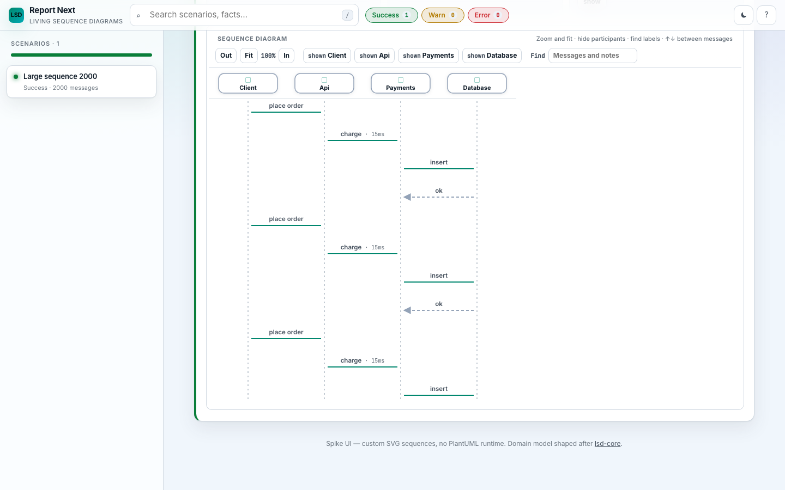
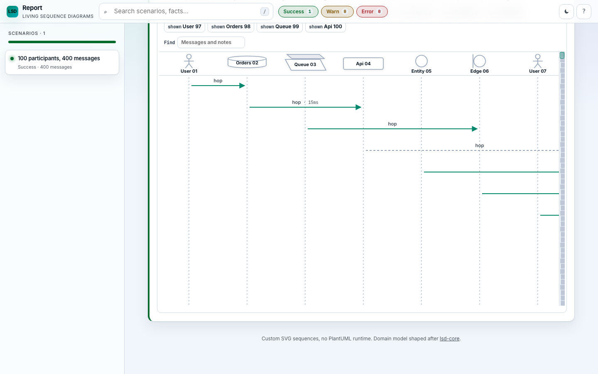

# Large-diagram browser check

Measured **3 Oct 2026, 16:33 BST** on an Apple M3 Max, macOS 26.6.2, headless Chromium **140.0.7339.16** (Playwright 1.55.0). Viewport 1440×900. One cold-ish context per page. Script: [`docs/perf/measure.mjs`](perf/measure.mjs). HTML opened with `file://` from gitignored `docs/perf-samples/`.

This is the run after `load`, with the legacy CDN scripts (`d3`, highlight.js) already cached. An earlier pass is only a caveat, not this table.

## Fixture

Same cycle on both sides, four participants (`Client`, `Api`, `Payments`, `Database`):

1. `Client` → `Api` sync, `place order`
2. `Api` → `Payments` sync, `charge`, **15 ms** duration
3. `Payments` → `Database` sync, `insert`
4. `Database` → `Payments` sync response, `ok`

25 / 125 / 500 cycles = **100 / 500 / 2000** messages, plus one note over `Api`: `needle-100`, `needle-500`, `needle-2000`. No `newpage` and no mono section. Legacy `completeReport` also renders the component diagram (the extra, smaller SVG in each file). Mono components stayed off. Virtualisation is the normal shell path.

Legacy overrides for this run: `devMode=false`, label width 200, metrics on. Split uses cap **50** (the default). One-SVG uses cap **10000**.

## Generation (not the browser table)

| Side | Events | Generate | HTML | SVGs |
|------|--------|----------|------|------|
| mono | 100 | 33 ms | 82 KB | shell |
| mono | 500 | 12 ms | 160 KB | shell |
| mono | 2000 | 22 ms | 452 KB | shell |
| legacy-split-50 | 100 | 32 ms | 123 KB | 3 |
| legacy-split-50 | 500 | 154 ms | 566 KB | 11 |
| legacy-split-50 | 2000 | 964 ms | 2.2 MB | 41 |
| legacy-one-svg | 100 | 39 ms | 120 KB | 2 |
| legacy-one-svg | 500 | 72 ms | 541 KB | 2 |
| legacy-one-svg | 2000 | 998 ms | 2.1 MB | 2 |

The 2000-event single SVG is real PlantUML: `height:58778px`, no syntax error. PlantUML did not time out.

## Browser

First interactive is wall time from `goto` (`waitUntil: commit`) until the diagram is visible: mono `.seq-sticky-header`, legacy `section.sequence svg`. Scroll is a 2 s `requestAnimationFrame` sweep of the mono `.seq-scroll` or the legacy page. Frame times are those rAF deltas (~121 frames, so about 60 Hz). Heap is CDP `JSHeapUsedSize` (V8, not the DOM). Search and zoom are mono only. DOM node counts are `getElementsByTagName('*').length` after load.

| Date | Machine | Chrome | Size | Side | First interactive ms | FCP ms | p95 frame ms | Longest frame ms | Heap after load | Heap after scroll | Search ms | Zoom ms | Pass/fail | Note |
|------|---------|--------|------|------|----------------------|--------|--------------|-------------------|-----------------|-------------------|-----------|---------|-----------|------|
| 2026-10-03 | M3 Max | Chromium 140.0.7339.16 | 100 | mono | 205 | 148 | 16.8 | 16.8 | 2,816,572 | 2,110,624 | 43 | 49 | pass | 276 DOM nodes; `[match]` shown |
| 2026-10-03 | M3 Max | Chromium 140.0.7339.16 | 100 | legacy-split-50 | 24 | 108 | 16.8 | 16.8 | 12,993,760 | 9,488,968 | — | — | pass | 1,378 nodes; 1 long task, 69 ms |
| 2026-10-03 | M3 Max | Chromium 140.0.7339.16 | 100 | legacy-one-svg | 28 | 104 | 16.7 | 16.8 | 13,031,496 | 9,488,504 | — | — | pass | 1,342 nodes; 1 long task, 70 ms |
| 2026-10-03 | M3 Max | Chromium 140.0.7339.16 | 500 | mono | 114 | 132 | 16.7 | 16.8 | 2,902,124 | 2,450,088 | 34 | 47 | pass | 276 DOM nodes; `[match]` shown |
| 2026-10-03 | M3 Max | Chromium 140.0.7339.16 | 500 | legacy-split-50 | 39 | 112 | 16.8 | 16.8 | 22,122,892 | 9,552,300 | — | — | pass | 6,098 nodes; 1 long task, 114 ms |
| 2026-10-03 | M3 Max | Chromium 140.0.7339.16 | 500 | legacy-one-svg | 42 | 124 | 16.7 | 16.8 | 20,558,720 | 9,503,500 | — | — | pass | 5,742 nodes; 1 long task, 112 ms |
| 2026-10-03 | M3 Max | Chromium 140.0.7339.16 | 2000 | mono | 112 | 128 | 16.7 | 16.8 | 2,513,904 | 2,412,344 | 6 | 33 | pass | 276 DOM nodes; header, zoom, `[match]` all fine |
| 2026-10-03 | M3 Max | Chromium 140.0.7339.16 | 2000 | legacy-split-50 | 470 | 164 | 16.7 | 16.8 | 53,884,820 | 10,000,084 | — | — | n/a | 23,798 nodes; 41 SVGs; 3 long tasks, max 267 ms. Not the win condition |
| 2026-10-03 | M3 Max | Chromium 140.0.7339.16 | 2000 | legacy-one-svg | 450 | 156 | 16.7 | 16.8 | 44,541,856 | 9,880,996 | — | — | pass | 22,242 nodes; SVG 58,778 px tall; 3 long tasks, max 254 ms. No multi-second freeze |

## Verdict



*4 participants, 2000 messages, from the local harness page.*

Mono stays usable at 2000 events: the participant header is on screen in about 112 ms, scroll frames stay on a 16.8 ms vsync, zoom is 33 ms, find is 6 ms, and `needle-2000` shows `[match]`. The DOM stays at 276 nodes at 100, 500, and 2000 because only the visible rows are painted. The single legacy SVG does **not** fall over on this machine: PlantUML finished in 998 ms, the first sequence SVG was visible in 450 ms, and the scripted scroll did not freeze. It is a much heavier page (22,242 nodes, about 44 MB of JS heap after load, a 58,778 px SVG, and long tasks up to 254 ms). Headless `scrollTop` on an M3 Max is a weak test of raster jank, so this run does not show the failure mode the pass bar expected; it does show mono doing the same scenario with a flat DOM and no long tasks.

## Caveats

- Headless Chromium, one published run, not a manual Performance trace. Frame p95 near 16.7 ms means the sweep kept up with vsync; it does not mean a real drag on a slower laptop would feel the same.
- Legacy HTML pulls `d3` and highlight.js from jsDelivr. The first pass, before that cache was warm, recorded one 3,374 ms frame on `legacy-split-50` at 100 events and did not repeat it. That pass also saw the 2000-event single SVG’s sequence element at 92 ms, before `load`. The table above is the second pass, sampled after `load`.
- `JSHeapUsedSize` drops after the scroll on the legacy pages (GC). It is not GPU or DOM memory. Node count is the better size signal.
- Split-at-50 can paint quickly because each SVG is small. At 2000 events that is 40 sequence diagrams plus the component SVG, with activations removed. That is a different product, not a win over mono.

## Samples

The HTML is generated and not committed. `docs/perf-samples/` is in `.gitignore` because the 2000-event legacy pages and the payload scripts are a few megabytes each. Rebuild the mono pages with [`docs/perf/generate-mono.mjs`](perf/generate-mono.mjs). The timings above come from [`docs/perf/measure.mjs`](perf/measure.mjs). Those scripts write:

- `mono-100-diagram.html`
- `mono-500-diagram.html`
- `mono-2000-diagram.html`
- `legacy-split-50-100.html`
- `legacy-split-50-500.html`
- `legacy-split-50-2000.html`
- `legacy-one-svg-100.html`
- `legacy-one-svg-500.html`
- `legacy-one-svg-2000.html`

The legacy files are the earlier lsd-core fixture. Nothing in this repo regenerates them.

## Rerun — arrow payloads and click (3 Oct 2026, 17:17 BST)

Same machine (Apple M3 Max, macOS 26.6.2), same headless Chromium **140.0.7339.16** (Playwright 1.55.0), viewport 1440×900. Script: [`docs/perf/measure.mjs`](perf/measure.mjs). Mono HTML regenerated by [`docs/perf/generate-mono.mjs`](perf/generate-mono.mjs) into the current report shell. Legacy HTML is the previous fixture, remeasured only so the harness still has a side-by-side.

This is **not** a replacement of the baseline above. That run had no per-arrow payload. This one does.

### What changed in the fixture

Every mono message carries a popup payload of **2,770 bytes** of JSON: `method`, `path`, `status`, `headers` (including a long trace id), and a `body` with 12 line items. Marker string `arrow-payload`. 100 / 500 / 2000 messages, so the 2000-event page holds about **5.5 MB** of backing data (HTML **9.9 MB**, was 452 KB). The note `needle-100` / `needle-500` / `needle-2000` is unchanged. After first interactive, search, and zoom, the script scrolls to message **1** and to the mid message (**50 / 250 / 1000**), clicks that arrow's button, and waits until `#dialog-pre` contains that message's `orderId`.

### Mono, old vs new

| | Baseline (no payload) | This run (2.8 KB × N, plus two arrow clicks) |
|--|----------------------|-----------------------------------------------|
| 2000 first interactive | 112 ms | **183 ms** |
| 2000 JS heap after load | 2.5 MB (2,513,904) | **9.6 MB (9,635,680)** |
| 2000 DOM nodes after load | 276 | **274** |
| 2000 click → popup | not measured | **35 ms** first (`place order`, id 1) and **35 ms** mid (`ok`, id 1000) |
| 2000 heap / DOM with popup open | — | **11.7 MB (11,677,520)** / **318** nodes |
| 2000 long tasks | none | none during scroll; none after the clicks |
| 500 first interactive | 114 ms | 113 ms |
| 500 heap / DOM | 2,902,124 / 276 | 4,267,124 / 274 |
| 500 click → popup | — | 35 ms (id 1), 37 ms (id 250); popup heap 4,665,208; DOM 319 |
| 100 first interactive | 205 ms | 118 ms |
| 100 heap / DOM | 2,816,572 / 276 | 3,151,244 / 274 |
| 100 click → popup | — | 34 ms (id 1), 35 ms (id 50); popup DOM 313 |

Search and zoom still pass (2000: find 33 ms, zoom 35 ms, `needle-2000` shows `[match]`). Frame p95 stays 16.7 ms. The DOM does not grow with the event count; the extra nodes after the click are the open dialog. The heap does grow, by roughly the parsed payloads (about +7 MB at 2000 versus the 2.5 MB baseline) and a bit more once the popup string is built.

### Full table (this pass)

| Date | Machine | Chrome | Size | Side | First interactive ms | FCP ms | p95 frame ms | Longest frame ms | Heap after load | Heap after scroll | Search ms | Zoom ms | Popup first ms | Popup mid ms | Heap after popup | DOM after load | DOM after popup | Pass/fail | Note |
|------|---------|--------|------|------|----------------------|--------|--------------|-------------------|-----------------|-------------------|-----------|---------|----------------|--------------|------------------|----------------|-----------------|-----------|------|
| 2026-10-03 | M3 Max | Chromium 140.0.7339.16 | 100 | mono | 118 | 140 | 16.7 | 16.8 | 3,151,244 | 2,973,776 | 33 | 37 | 34 | 35 | 2,675,064 | 274 | 313 | pass | ids 1 and 50; 0 long tasks |
| 2026-10-03 | M3 Max | Chromium 140.0.7339.16 | 100 | legacy-split-50 | 25 | 120 | 16.7 | 16.8 | 13,012,864 | 9,489,608 | — | — | — | — | — | 1,378 | — | pass | unchanged fixture; 1 long task, 69 ms |
| 2026-10-03 | M3 Max | Chromium 140.0.7339.16 | 100 | legacy-one-svg | 28 | 72 | 16.7 | 16.8 | 13,005,880 | 9,488,504 | — | — | — | — | — | 1,342 | — | pass | unchanged fixture; 1 long task, 68 ms |
| 2026-10-03 | M3 Max | Chromium 140.0.7339.16 | 500 | mono | 113 | 136 | 16.7 | 16.8 | 4,267,124 | 3,698,172 | 32 | 29 | 35 | 37 | 4,665,208 | 274 | 319 | pass | ids 1 and 250; 0 long tasks |
| 2026-10-03 | M3 Max | Chromium 140.0.7339.16 | 500 | legacy-split-50 | 40 | 96 | 16.8 | 16.8 | 23,661,628 | 9,551,556 | — | — | — | — | — | 6,098 | — | pass | unchanged fixture; 1 long task, 114 ms |
| 2026-10-03 | M3 Max | Chromium 140.0.7339.16 | 500 | legacy-one-svg | 43 | 112 | 16.7 | 16.8 | 20,564,736 | 9,503,752 | — | — | — | — | — | 5,742 | — | pass | unchanged fixture; 1 long task, 113 ms |
| 2026-10-03 | M3 Max | Chromium 140.0.7339.16 | 2000 | mono | 183 | 184 | 16.7 | 16.8 | 9,635,680 | 10,556,012 | 33 | 35 | 35 | 35 | 11,677,520 | 274 | 318 | pass | ids 1 and 1000; header, zoom, `[match]` fine; 0 long tasks |
| 2026-10-03 | M3 Max | Chromium 140.0.7339.16 | 2000 | legacy-split-50 | 484 | 168 | 16.8 | 16.8 | 53,734,824 | 9,999,676 | — | — | — | — | — | 23,798 | — | n/a | unchanged fixture; 3 long tasks, max 276 ms |
| 2026-10-03 | M3 Max | Chromium 140.0.7339.16 | 2000 | legacy-one-svg | 454 | 164 | 16.8 | 16.8 | 44,862,064 | 9,881,080 | — | — | — | — | — | 22,242 | — | pass | unchanged fixture; 3 long tasks, max 255 ms |

### Verdict of this rerun

Mono at 2000 events is still usable with the backing data in memory. First interactive moved from **112 ms to 183 ms**, and the heap from **2.5 MB to 9.6 MB** (11.7 MB with the popup open). The DOM stayed flat at **274** nodes (baseline 276) and **318** once the dialog is open. Opening an arrow is about **35 ms** for both the top message and message 1000. No long tasks on the mono pages. Legacy numbers are in the same band as the baseline; those files were not rebuilt.

## Wide participants (3 Oct 2026, 20:11 BST)

This is a **separate run** from the 4-participant tables above. It does not replace them.



*100 participants, 400 messages, from the local harness page.*

Same machine (Apple M3 Max, macOS, headless Chromium **140.0.7339.16**, Playwright 1.55.0), viewport 1440×900. The diagram's own scrollport is 963×611 inside that viewport (sidebar and the stage cap). Scripts: [`docs/perf/generate-wide.mjs`](perf/generate-wide.mjs) and [`docs/perf/measure-wide.mjs`](perf/measure-wide.mjs). HTML opened with `file://` from `docs/perf-samples/` (gitignored).

### What this is next to

The 4-participant, 2000-event rerun above is the baseline for "lots of messages": first interactive **183 ms**, JS heap **9.6 MB (9,635,680)** with the payloads **inlined** in the HTML, DOM **274**. After payloads were split out of the HTML, that same 4-participant page on disk is **454,967 bytes** (~455 KB) plus a sibling `mono-2000-payloads.js` (5,643,568 bytes). That lazy page was not remeasured in the browser for this section. The wide run below is the lazy shape from the start: method, path, and status stay on the message, and the rest of the JSON loads when the inspector opens.

### Fixture

Participants cycle through actor, database, queue, component, entity, and boundary, so the header shapes are in the measurement. Names are short (`User 01`, `Orders 02`, `Queue 03`, …). Messages hop across the columns, and every 25th message spans the first participant to the last. The first message is a one-column hop on the left, so Fit has a top label near the origin. Each message has the same ~2.7 KB popup body as the earlier payload fixture (`arrow-payload`, `orderId`). No search and no zoom-button timing. One click, on message 1, after Fit. JSON is already expanded when the inspector opens. That click is included in the times below.

| Participants | Messages | HTML | Sibling payloads |
|--------------|----------|------|------------------|
| 20 | 400 | 160,806 bytes | 1,112,471 bytes |
| 50 | 400 | 162,247 bytes | 1,112,531 bytes |
| 100 | 400 | 165,078 bytes | 1,113,011 bytes |
| 100 | 2000 | 471,608 bytes | 5,619,888 bytes |

Logical diagram width is 2,804 / 7,004 / 14,004 px (140 px column gap). At 100% zoom the scrollport's horizontal overflow is 1,841 / 6,041 / 13,041 px.

### Browser (after the scrollport fix below)

First interactive is wall time from `goto` (`waitUntil: commit`) until `.seq-sticky-header` is visible. The sweep is 2 s of `requestAnimationFrame`, moving vertical and horizontal scroll together. Heap is CDP `JSHeapUsedSize`. DOM counts are `getElementsByTagName('*').length`. Header nodes are elements inside `.seq-sticky-header` only. Those grow with the participant count. Message rows stay virtualised: 100 participants is 1,101 nodes at both 400 and 2,000 messages.

| Participants | Messages | First interactive ms | FCP ms | p95 frame ms | Longest frame ms | Heap after load | Heap after scroll | Heap after popup | DOM | Header nodes | Popup ms | Long tasks |
|--------------|----------|----------------------|--------|--------------|-------------------|-----------------|-------------------|------------------|-----|--------------|----------|------------|
| 20 | 400 | 112 | 136 | 16.8 | 16.8 | 2,684,412 | 2,179,872 | 5,122,800 | 435 | 109 | 66 | 0 |
| 50 | 400 | 95 | 116 | 16.8 | 16.8 | 2,749,808 | 2,464,652 | 5,685,772 | 685 | 269 | 66 | 0 |
| 100 | 400 | 100 | 120 | 16.8 | 16.8 | 3,157,360 | 2,855,036 | 4,638,824 | 1,101 | 535 | 66 | 0 |
| 100 | 2000 | 104 | 124 | 16.8 | 16.8 | 4,626,280 | 5,723,108 | 12,258,316 | 1,101 | 535 | 89 | 0 |

Popup DOM is 7 nodes higher (442 / 692 / 1,108 / 1,108). The 100×2000 popup heap (12.3 MB) is the sibling payload script being parsed on that click. The other three clicks also load their ~1.1 MB sibling. Heap moves around with GC. It is not a DOM-size signal.

Horizontal scroll works on all four. `.seq-scroll` is `overflow: auto`. Setting `scrollLeft` to the maximum lands on it (1,841 / 6,041 / 13,041). The last participant label is then inside the scrollport and the first label is off the left edge, so the sticky header moves with the horizontal scroll rather than staying painted at the left. During the vertical sweep the header stays stuck to the top of the scrollport. No label bounding boxes overlap at 100% zoom (0 overlaps at 20, 50, and 100). Shapes in the 100-participant header: 17 actor, 17 database, 17 queue, 17 component, 16 entity, 16 boundary.

Fit, after the zoom animation settles (`scrollTop` 0):

| Participants | Fit zoom | Top label in the scrollport | Label size | Horizontal overflow left after Fit |
|--------------|----------|------------------------------|------------|-------------------------------------|
| 20 | 34% | yes (`hop`, message 1) | 7×5 px | 0 (scroll width equals the 963 px client width) |
| 50 | 25% (the floor) | yes | 5×4 px | 788 px |
| 100 | 25% (the floor) | yes | 5×4 px | 2,538 px |

The visible word is `hop`. The DOM text is `hophop` because the SVG `<title>` repeats it. 50 and 100 participants do not fit the width: zoom stops at 25%, so Fit still leaves a horizontal scrollbar. The top label is on screen, but only a few pixels tall. That is the clamp, not a clip of the label box.

The show/hide buttons wrap. Their block is 96 px tall at 20 participants, 232 px at 50, and 436 px at 100. At 100 participants the diagram header's document position is about y=954, which is below this 900 px viewport until the page itself is scrolled. The buttons do not overflow horizontally (953 px scroll width in a 953 px row). Labels in the header do not collide.

### What was broken, and the small fix

The first pass, before the CSS change, still scrolled horizontally, and the header labels did not overlap. Vertical scrolling did not. `.seq-stage` was capped at 612 px, but its auto row sized to the drawing, so `.seq-scroll` grew to the content. On the 100×2000 page that was client height **104,149** equal to the scroll height, **15,482** DOM nodes (every row painted), **22** frames in the 2 s sweep, p95 **150 ms**, **20** long tasks up to **148 ms**, first interactive **245 ms**. The page scroll height stayed about 1,700 px, so the drawing below the stage could not be reached.

The change is only the stage row: `grid-template-rows: minmax(0, min(68vh, 640px))` and `overflow: hidden`, with the print rule turning that clip off. Remeasured numbers are the table above. Scrollport client height is **611** px on every case. 100 participants is **1,101** nodes at both 400 and 2,000 messages, frame p95 is **16.8 ms**, and there were no long tasks.

### Samples

Regenerate these with [`docs/perf/generate-wide.mjs`](perf/generate-wide.mjs). The timings above come from [`docs/perf/measure-wide.mjs`](perf/measure-wide.mjs). Output goes to gitignored `docs/perf-samples/`:

- `mono-p20-m400-diagram.html`
- `mono-p50-m400-diagram.html`
- `mono-p100-m400-diagram.html`
- `mono-p100-m2000-diagram.html`

Each has a sibling `*-payloads.js` next to it.

## Rerun on Chromium 156 (14 Oct 2026, 19:45 BST)

Same machine (Apple M3 Max), headless Chromium **156.0.8078.4**, viewport 1440×900. The sections above used Chromium 140. Mono and wide pages were regenerated into the current report shell, which now has the single-scenario view, the Timing view, the participant filter, and page-scrolling tall diagrams. Legacy pages are the unchanged fixture.

Commands, run from the repository root with Node 22 and no loader:

```
cd modules/lsd-mono-core/report && npm run build:single && cd -
node --experimental-strip-types docs/perf/generate-mono.mjs modules/lsd-mono-core/report/dist/lsd-report.html docs/perf-samples
node --experimental-strip-types docs/perf/generate-wide.mjs modules/lsd-mono-core/report/dist/lsd-report.html docs/perf-samples
node docs/perf/measure.mjs "$PWD/docs/perf-samples"
node docs/perf/measure-wide.mjs "$PWD/docs/perf-samples"
```

Harness changes in this run:

- `payloads.ts` imports `./escape.ts`, so Node's type stripping can load it from the generators.
- `measure.mjs` loads Playwright from the report's `node_modules`, like `measure-wide.mjs`.
- The inspector expands the JSON by itself once the payload loads. `measure.mjs` used to click the toggle, which collapsed it again, so it now waits for `aria-expanded="true"` and the payload text.
- A diagram taller than the window now scrolls with the page. `measure.mjs` scrolls the page to reach the mid message, and retries because closing the inspector returns focus to the previous arrow.

### Mono (4 participants, 2.8 KB payload per arrow)

| Size | First interactive ms | FCP ms | p95 frame ms | Longest frame ms | Long tasks | Heap after load | DOM | Search ms | Zoom ms | Popup first ms | Popup mid ms | 3 Oct (Chromium 140) |
|------|----------------------|--------|--------------|-------------------|------------|-----------------|-----|-----------|---------|----------------|--------------|----------------------|
| 100 | 129 | 212 | 16.8 | 83.4 | 1 (73 ms) | 3,273,836 | 373 | 5 | 39 | 39 | 30 | 118 ms, DOM 274, popups 34 / 35 |
| 500 | 129 | — | 16.8 | 49.9 | 0 | 3,779,464 | 373 | 5 | 35 | 62 | 26 | 113 ms, DOM 274, popups 35 / 37 |
| 2000 | 210 | 204 | 16.8 | 49.9 | 0 | 5,356,212 | 373 | 6 | 36 | 75 | 29 | 183 ms, DOM 274, popups 35 / 35 |

All three pass: the header is visible, zoom and find work, `needle-N` shows `[match]`, and both arrows open with their payload. Earlier runs today put mono 2000 first interactive at 124–126 ms, so 210 ms is within run-to-run spread. The heap after load is lower than on 3 Oct (5.4 MB against 9.6 MB at 2000) because payloads are now in the sibling script. Find is faster (6 ms against 33 ms). The 100-event long task is on the first page the browser opens.

Legacy, for reference: first interactive 25 / 36 / 84 ms (split) and 27 / 40 / 82 ms (one SVG) at 100 / 500 / 2000, DOM unchanged (1,378 to 23,798), one long task each, up to 243 ms at 2000.

### Wide participants

| Participants | Messages | First interactive ms | p95 frame ms | Long tasks | DOM | Header nodes | Popup ms | Fit zoom | 3 Oct (Chromium 140) |
|--------------|----------|----------------------|--------------|------------|-----|--------------|----------|----------|----------------------|
| 20 | 400 | 195 | 16.7 | 0 | 851 | 310 | 67 | 35% | 112 ms, DOM 435, header 109, popup 66 |
| 50 | 400 | 119 | 16.7 | 1 (50 ms) | 1,472 | 770 | 82 | 25% | 95 ms, DOM 685, header 269, popup 66 |
| 100 | 400 | 136 | 16.7 | 1 (59 ms) | 2,288 | 1,536 | 83 | 25% | 100 ms, DOM 1,101, header 535, popup 66 |
| 100 | 2000 | 144 | 16.7 | 1 (64 ms) | 2,288 | 1,536 | 152 | 25% | 104 ms, DOM 1,101, header 535, popup 89 |

Horizontal scroll, the sticky header during the vertical sweep, label overlap (0) and the Fit top label all pass. The scrollport is now 803 px tall (611 px before), because the diagram takes the window height and scrolls with the page.

### Changes against the baseline

- **DOM size.** Mono pages are 373 nodes (274 before). The wide header roughly triples (535 to 1,536 nodes at 100 participants) because each participant now has its own header actions for the participant filter. Message rows are still windowed: 100 participants is 2,288 nodes at both 400 and 2,000 messages.
- **Wide popup.** The 100×2000 click takes 152 ms (89 ms before) and the 400-message clicks 67–83 ms (66 ms before). Most of the 100×2000 time is parsing the 5.6 MB sibling payload script on that click.
- **Long tasks.** The wide pages show one 50–64 ms long task each (none before). Frame p95 stays at 16.7 ms on every page.
- First interactive is within 20–90 ms of the 3 Oct numbers, and varies by that much between runs.

## Participant header buttons rendered once (19 Oct 2026, 21:40 BST)

Each participant header used to carry its own Hide and More buttons (ten nodes each). There is now one set, moved onto the header that is hovered, tapped, focused or opened from the keyboard ([#62](https://github.com/lsd-consulting/lsd-mono/issues/62)). Same machine (Apple M3 Max), headless Chromium **156.0.8078.4**, viewport 1440×900, `measure-wide.mjs`, Node 22 (Node only drives Playwright here; CI uses the version in `.nvmrc`, 24). "Before" is the same build without the change, measured straight before it. Both use the 95% Fit floor from #81.

| Participants | Messages | Header nodes before → after | DOM before → after | Long tasks before → after | First interactive ms before → after | Popup ms before → after |
|--------------|----------|-----------------------------|--------------------|---------------------------|-------------------------------------|-------------------------|
| 20 | 400 | 310 → 139 | 1,133 → 962 | 0 → 0 | 78 → 78 | 68 → 67 |
| 50 | 400 | 770 → 329 | 1,623 → 1,182 | 1 (51 ms) → 0 | 81 → 75 | 83 → 66 |
| 100 | 400 | 1,536 → 645 | 2,439 → 1,548 | 1 (58 ms) → 1 (50 ms) | 89 → 80 | 83 → 84 |
| 100 | 2000 | 1,536 → 645 | 4,039 → 3,148 | 1 (81 ms) → 1 (75 ms) | 125 → 118 | 156 → 153 |

At 100 participants the header is 645 nodes against 535 before the participant filter: one slot per participant (100) plus the one set of buttons. p95 frame time stays at 16.7–16.8 ms. The 100-participant pages still show one 50–75 ms long task; this change did not look into it. The 100×2000 popup is [#63](https://github.com/lsd-consulting/lsd-mono/issues/63).

Regenerate with the commands in the Chromium 156 rerun above (`generate-wide.mjs` now takes its participants and arrows from `report/checks/wide-sample.ts`, which the check:ux tests also open).

## Payloads parsed when opened (19 Oct 2026, 21:41 BST)

`-payloads.js` used to be one object literal, so the first popup on a large report had to evaluate every payload ([#63](https://github.com/lsd-consulting/lsd-mono/issues/63)). It is now `window.__LSD_PAYLOAD_TEXT__`, which maps each payload id to its compact JSON text. Each payload is parsed with `JSON.parse` the first time it is read and then cached. Find over payloads parses them one index slice at a time. The page still works offline from `file://`. The index page still reads an older `window.__LSD_PAYLOADS__` script. Same machine (Apple M3 Max), headless Chromium 156, Node 22 (Node only drives Playwright here; CI uses the version in `.nvmrc`, 24). "Before" is the build with #62, measured straight before this change.

| Measurement (100 participants × 2000 messages) | Before | After |
|---|---|---|
| First popup, `measure-wide.mjs` (3 runs, ms) | 153 / 150 / 153 | 82 / 83 / 83 |
| First popup, in-page click to rendered (ms) | 78–97 | 55–66 |
| Popup at 400 messages (ms) | 66–69 | 66–69 |
| Payload file (bytes) | 5,619,888 | 6,151,892 (+9%, escaped quotes) |
| Script evaluation only, microbench (ms) | 26 | 11 (+ a few ms per opened payload) |

Find over payloads (`measure-find.mjs`, case `mono-p100-m2000`):

| CPU throttle | Measurement | Before | After |
|---|---|---|---|
| 1× | Cold first search (ms) | 57–63 | 44–51 |
| 1× | Payload parse (ms) | 41–46 | 17–23 |
| 6× | Cold first search (ms) | 174–182 | 212–227 |
| 6× | Longest task during cold search (ms) | 24–28 | 26–31 |
| 6× | Warm first search (ms) | 107–113 | 161–166 |
| 6× | Long tasks over 50 ms while typing | 0 | 0 |
| — | Payload heap (MB) | 4.8 | 5.7 |

The popup now meets the 90 ms target. The cost is that at 6× throttle the first search over payloads takes about 40–50 ms longer, because parsing moved out of page load into the index slices. No task in it is over 50 ms, so typing stays responsive. Without throttling it is faster.

Rerun with the commands in "Find over payloads" below: `measure-wide.mjs` gives the popup, and `measure-find.mjs <samples-dir> mono-p100-m2000:1:1` (or `:6:1`) gives one find case. After the 100×2000 popup, the page logs two long tasks of about 58 ms, the same as before (two, 57 ms). This change did not look into them.

## Report index at 200 reports (14 Oct 2026, 20:20 BST)

`index.html` is the report app with a manifest of every report in the directory. A report's data
(`<stem>-report.js`) loads only when it is opened. This checks that the index stays cheap for a large suite.
Measured on an Apple M3 Max, headless Chromium 156 (Playwright 1.64.0), viewport 1280×800, `file://`.

### Fixture

[`IndexPerf.java`](perf/IndexPerf.java): 200 test classes, each one report of 5 scenarios with 20
call/reply pairs (40 arrows) and a ~250-byte payload per call. 12 scenarios fail and 19 warn. Each class
runs `completeReport` and then `createIndex`, as the JUnit extension does.

| File (per report) | Size |
| --- | --- |
| `-report.js` (loaded when opened) | 70.6 KB |
| `-payloads.js` (loaded when a message opens) | 27.1 KB |
| `-diagram.html` (the report on its own) | 219.7 KB |
| `-report.json` | 97.9 KB |
| `index.html` for all 200 | **362 KB** (55.7 KB gzipped): the ~150 KB shell plus ~1 KB of manifest per report |

The whole directory is 83 MB, but the index page reads only `index.html` plus one report.

### Writing the index

| | Time |
| --- | --- |
| `createIndex` after each class, median of classes 181–200 | 3.5 ms |
| `createIndex` after class 1 (JVM warm-up) | 9 ms |
| `createIndex` in a fresh JVM over 200 entries (a new test fork) | 87 ms |
| `completeReport` per class, after warm-up | 2–3 ms |

Index entries are cached by modification time, so each later call rereads only the entries that changed.
The cost per class grows slowly with the number of reports (2 ms at 10 reports, 3 ms at 200).

### Browser ([`measure-index.mjs`](perf/measure-index.mjs), 5 runs, medians)

| | 200 reports | 5 reports |
| --- | --- | --- |
| `goto` to the first diagram drawn (failed report opens first) | 179 ms | 173 ms |
| JS heap after load (after GC) | 2.0 MB | 1.7 MB |
| JS heap after opening 20 other reports | 3.0 MB | 2.3 MB |
| Switching to another report (`#report=`), until its diagram is drawn | 26 ms (p90 27, max 31) | — |
| Sidebar rows | 205 (200 report rows plus the open report's 5 scenarios) | 8 |

The first view costs about the same at 200 reports as at 5. Switching reports loads one 70 KB script and
draws one diagram. Reports that were opened before stay in memory (about 50 KB of heap each here).

To rerun (after `./gradlew :modules:lsd-mono-core:jar`):

```bash
CP=modules/lsd-mono-core/build/libs/lsd-mono-core-0.0.1-SNAPSHOT.jar:$(find ~/.gradle/caches -name 'kotlin-stdlib-2.3.10.jar' | head -1)
java -cp "$CP" docs/perf/IndexPerf.java 200 /tmp/lsd-index-200
java -cp "$CP" docs/perf/IndexPerfCold.java /tmp/lsd-index-200
node docs/perf/measure-index.mjs /tmp/lsd-index-200
```

## Find over payloads (19 Oct 2026, 07:40 BST)

Find matches message payloads as well as labels and notes (#60). The payloads load the first time Find is used, are indexed as the side panel shows them (indented JSON, case folded), and are indexed and searched in slices of about 8 ms, so typing never waits for a large report. Same machine (Apple M3 Max), headless Chromium **156.0.8078.4**, viewport 1440×900, `file://`. Samples regenerated from the current shell, as in the Chromium 156 rerun above. [`measure-find.mjs`](perf/measure-find.mjs), 3 runs per row, medians (ranges where they matter).

```
cd modules/lsd-mono-core/report && npm run build:single && cd -
node --experimental-strip-types docs/perf/generate-mono.mjs modules/lsd-mono-core/report/dist/lsd-report.html docs/perf-samples
node --experimental-strip-types docs/perf/generate-wide.mjs modules/lsd-mono-core/report/dist/lsd-report.html docs/perf-samples
node docs/perf/measure-find.mjs "$PWD/docs/perf-samples"
```

- **Cold first search**: the first key in Find on a fresh page, `sock-1`, which loads the 5.6 MB payload script, indexes it and searches it, timed in the page from the key to the final count (`1 of 1111, 1111 in payloads`).
- **Longest task**: the longest gap between `MessageChannel` pings while it runs, so the longest stretch the page could not answer a key.
- **Keys**: eleven keys after it (`s` … `sock-199`, two Backspaces, `zzzz`). *Blocking* is the input handler; *answer* is until the count is final, which for a full search (Backspace, a new word) comes over several slices.
- **Heap**: CDP `JSHeapUsedSize` after GC, the payloads loaded by hand first so the index is told apart from them.
- **10×**: every payload repeated ten times as it loads (77 M characters of indented JSON).

| Page | CPU | Cold first search | Longest task | Key answer, median | Key blocking, max | Long tasks ≥ 50 ms while typing | Payloads off: key median / blocking max |
|---|---|---|---|---|---|---|---|
| mono-2000 (4 lanes) | 1× | 47 ms | 11 ms | 2.3 ms | 5.4 ms | 0 | 1.4 / 1.8 ms |
| mono-2000 | 6× | 168 ms | 25–30 ms | 14 ms | 20.5 ms | 0 | 7.8 / 9.5 ms |
| mono-p100-m2000 (100 lanes) | 1× | 57 ms | 11 ms | 3.4 ms | 6.3 ms | 0 | 2.3 / 3.1 ms |
| mono-p100-m2000 | 6× | 185 ms | 29–31 ms | 20 ms | 22.8 ms | 0 | 11.5 / 15.9 ms |
| mono-p100-m2000, 10× payloads | 1× | 151 ms | 13.5–13.7 ms | 4.5 ms | 11 ms | 0 | 2.3 / 3.5 ms |
| mono-p100-m2000, 10× payloads | 4× | 552 ms | 27–28 ms | 18 ms | 19 ms | 0 | 8.3 / 11.3 ms |

Of the 47 ms cold search at 2000 events, the payload script has run by 32 ms; indexing 7.3 M characters and searching them is the other 15 ms, in two slices. A full search's answer (Backspace, a new word) takes 59–61 ms at 6× on mono-2000 and 78–80 ms on the wide page, over slices, without blocking a key.

| Memory | Payload script | Payloads in the heap | Index |
|---|---|---|---|
| 2000 events | 5.6 MB | 4.9 MB | 7.5 MB (1.33× the script) |
| 2000 events, 10× | 56 MB | 6.0 MB (shared strings) | 77.6 MB (1.38×) |

The index holds each payload's indented text, about one byte per character.

**Side panel marks.** With the panel open on the first arrow, a key that marks 1000 matches in a 360 KB payload (10×, at the mark cap) blocks for 5.8–6.4 ms, against 3.4–3.5 ms with the panel closed: the marks add 2.4–2.9 ms. Before the mark was scrolled into view on the next frame they added about 6 ms (the payload was laid out twice). 235 marks in a 36 KB payload add under 0.5 ms.

**First load.** [`measure.mjs`](perf/measure.mjs) on the shell before #60 (8478279) and after, three rounds each, alternating:

| | 100 | 500 | 2000 |
|---|---|---|---|
| First interactive, before / after | 61–69 / 62–63 ms | 66–67 / 65–70 ms | 74–78 / 76–79 ms |
| Heap after load, before / after | 3.31 / 3.33 MB | 3.49 / 3.51 MB | 4.90 / 4.89–4.94 MB |
| Find `needle-N`, before / after | 5 ms (one 25) / 40–44 ms | 4–5 / 41–44 ms | 6 / 111–113 ms |
| First popup, before / after | 39–54 / 10–30 ms | 43–46 / 12–28 ms | 77 / 28–42 ms |

Find now waits for the payload answer too, so `measure.mjs`'s search includes loading and indexing the payloads. Its 111–113 ms at 2000 is in a browser that has just opened the 500-event legacy pages, after the scroll sweep, and is polled from Node; the in-page cold search above is 47 ms. The first popup is faster because Find has already loaded the payloads. `measure.mjs` now waits for that answer, then 300 ms for Find's reveal, before it scrolls to open arrows; without the wait, the reveal could move the page under the click.

The shell is 288,459 bytes, 10.6 KB more (140,037 bytes gzipped, 2.9 KB more).

### Against the budgets set for #60

| Budget | Result | |
|---|---|---|
| First load unchanged | First interactive and heap after load within run-to-run spread | met |
| Shell +≤ 4 KB | +2.9 KB gzipped, +10.6 KB raw | met gzipped, not raw |
| Key ≤ 10 ms on a desktop | 2.3–3.4 ms median, 6.3 ms worst (11 ms at 10×) | met |
| Key ≤ 25 ms at 6× CPU | 14–20 ms median, 22.8 ms worst blocking; a full search's answer arrives over slices in 59–80 ms | met for blocking and the median |
| First payload search ≤ 100 ms, no index slice > 16 ms (desktop) | 47–64 ms cold, longest task 11 ms (13.7 ms at 10×) | met |
| Index ≤ 1.5× payload size | 1.33× (1.38× at 10×) | met |
| No task > 50 ms while typing at 10× | none, at 1× and 4× CPU | met |
| 1000 marks ≤ 5 ms | 2.4–2.9 ms | met |
