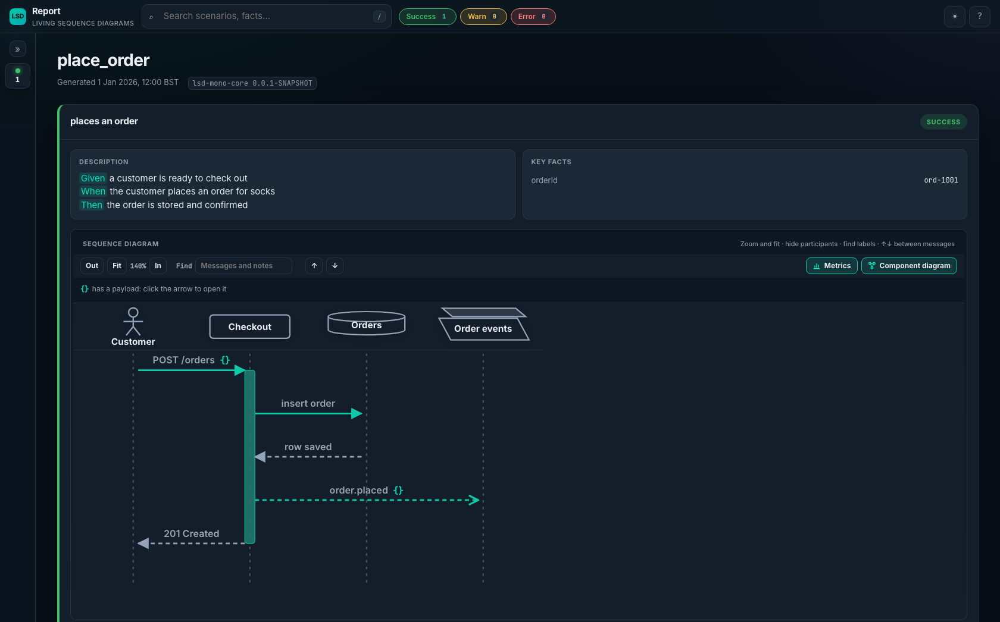

# lsd-mono-cucumber-8

Part of [LSD: living sequence diagrams](../../README.md).

`lsd-mono-cucumber-8` is the Cucumber 8 plugin for [lsd-mono-jvm](../lsd-mono-jvm) that turns each scenario into a living sequence diagram. You still capture the interactions yourself with `LsdContext` inside your steps. The plugin records pass, fail, or warning when the scenario ends, and writes the report when the feature finishes. It depends on first-party `lsd-mono-jvm`, not the old published `lsd-core`, and there is no PlantUML on this path. It is pinned to Cucumber 8: the catalog holds the exact version (`8.0.4`) and the build fails if anything resolves to another major. A newer Cucumber major gets its own module.

## Depend on it

<!-- release-version:start (the release workflow updates the versions up to the end marker) -->

[](https://central.sonatype.com/artifact/io.github.lsd-consulting/lsd-mono-cucumber-8)

```kotlin
testImplementation("io.github.lsd-consulting:lsd-mono-cucumber-8:0.15.0")
```

<!-- release-version:end -->

With a Cucumber 8 runtime and step-definition library:

```kotlin
testImplementation("io.cucumber:cucumber-java8:8.0.4")
testImplementation("io.cucumber:cucumber-junit-platform-engine:8.0.4")
```

`lsd-mono-cucumber-8` brings in `lsd-mono-jvm` and `io.cucumber:cucumber-plugin`. You still need a Cucumber 8 runtime and a step-definition library. `cucumber-java8` and `cucumber-junit-platform-engine` are the pair this module is tested with. Stay on Cucumber 8. This build rejects 7.x and 9+.

## Register the plugin

`src/test/resources/junit-platform.properties`:

```properties
cucumber.plugin=io.github.lsdconsulting.lsd.mono.cucumber.LsdCucumberPlugin
cucumber.glue=com.example.steps
cucumber.publish.enabled=false
```

The class is `io.github.lsdconsulting.lsd.mono.cucumber.LsdCucumberPlugin`. It implements Cucumber's `ConcurrentEventListener`.

Parallel execution is supported (`cucumber.execution.parallel.enabled=true`, or `--threads` on the CLI). Each scenario gets its own buffer, bound to the thread that runs its steps, so `LsdContext.instance` in a step lands in that scenario, and each feature gets its own report. Work a step hands to another thread needs `LsdContext.instance.wrap(task)`. A capture from a thread that is not bound to a scenario goes to the running scenario when there is only one; with several running it is logged as a warning and kept out of all of them.

In Kotlin coroutines, a thread binding does not follow the coroutine when it resumes on another dispatcher thread. Take `LsdContext.instance.currentScenario()` at the start of the step and bind it for the coroutine with `withLsdScenario` from [`lsd-mono-coroutines`](../lsd-mono-coroutines/README.md).

## Capture from a step

Do **not** call `completeScenario` or `completeReport` yourself. The plugin does that when the scenario and the feature finish.

```kotlin
import io.cucumber.java8.En
import io.github.lsdconsulting.lsd.mono.jvm.LsdContext
import io.github.lsdconsulting.lsd.mono.jvm.domain.ParticipantType.ACTOR
import io.github.lsdconsulting.lsd.mono.jvm.domain.ParticipantType.DATABASE
import io.github.lsdconsulting.lsd.mono.jvm.domain.ParticipantType.PARTICIPANT
import io.github.lsdconsulting.lsd.mono.jvm.domain.ParticipantType.QUEUE

class PlaceOrderSteps : En {
    init {
        val lsd = LsdContext.instance

        Given("a customer is ready to check out") {
            lsd.addParticipants(
                ACTOR.called("Customer"),
                PARTICIPANT.called("Checkout"),
                DATABASE.called("Orders"),
                QUEUE.called("Order events"),
            )
            lsd.addFact("orderId", "ord-1001")
        }

        When("the customer places an order for socks") {
            lsd.capture {
                "Customer" calls "Checkout" label "POST /orders" data mapOf(
                    "method" to "POST",
                    "path" to "/orders",
                    "status" to 201,
                    "body" to mapOf("sku" to "SOCK-1", "qty" to 2),
                )
                activate("Checkout")
                "Checkout" calls "Orders" label "insert order"
                "Orders" repliesTo "Checkout" label "row saved"
                "Checkout" sends "Order events" label "order.placed" data mapOf(
                    "orderId" to "ord-1001",
                    "sku" to "SOCK-1",
                )
            }
        }

        Then("the order is stored and confirmed") {
            lsd.capture {
                "Checkout" repliesTo "Customer" label "201 Created"
                deactivate("Checkout")
            }
        }
    }
}
```

```gherkin
Feature: Place an order

  Scenario: places an order
    Given a customer is ready to check out
    When the customer places an order for socks
    Then the order is stored and confirmed
```

A passed scenario is stored as a success. The scenario title is the Cucumber scenario name (`places an order`). A scenario outline example is suffixed ` #1`, ` #2`, and so on, numbered by the row's position in the feature file across all its `Examples` tables, so the numbers do not depend on run order. The description is the step lines as plain text; a step that did not pass ends with how it ended, such as `(failed)` or `(skipped)`. A failed scenario is stored with status error and a structured error (headline, message, stack). A pending, undefined, ambiguous or skipped scenario is a warning, and the report says why under its description:

| Result | Headline | Message |
|--------|----------|---------|
| Pending | `Pending` | The `PendingException` message, then `Step: <the step>` |
| Undefined | `Undefined step` | The step, then the step definition Cucumber suggests |
| Ambiguous | `Ambiguous step` | Cucumber's list of matching definitions, then the step |
| Skipped | `Skipped` | The reason (an assumption's message), then the step |

These carry no stack trace; a failure keeps its stack behind **Show stack trace**.

Set `lsd.mono.cucumber.splitBySteps=true` to insert a section at each step (every property is listed in the [core README](../../docs/jvm-api.md#configuration-reference)). That stays in the same diagram. It is not a new page. The step a scenario stopped at gets its section; the steps Cucumber then skips get none, because they never run, and the description lists them as `(skipped)`.

## Where the report is written

After the run finishes, open:

```text
build/reports/lsd/place_order-<hash>-diagram.html
```

The report is titled by the feature's name (`Feature: Place an order` gives `Place an order`), or by the file name without `.feature` when the name is blank. The file name comes from the feature file (`place_order.feature`), not from the `Feature:` name, so a renamed feature keeps its files and links. `<hash>` is 8 hex characters from the feature's path, so two `place_order.feature` files in different folders get separate reports. That file is the report. The plugin writes every feature's report when the run finishes, then `index.html`, which shows every report in the directory in one page, failed first.

Override the directory with `lsd.mono.report.outputDir`.

Click an arrow to open its JSON. `method`, `path`, and `status` stay on the arrow. Other fields load from the companion payloads file when the panel opens. Participant types set the header shape: `ACTOR`, `DATABASE`, `QUEUE`, and so on.

## What the report looks like

The diagram for the scenario above after a successful feature.



How to regenerate it is in [CONTRIBUTING.md](../../CONTRIBUTING.md#module-readme-screenshots).

## Build

```bash
./gradlew :modules:lsd-mono-cucumber-8:build
```

JDK 21. See the [root README](../../README.md) for the core capture API and the shared report UI.
