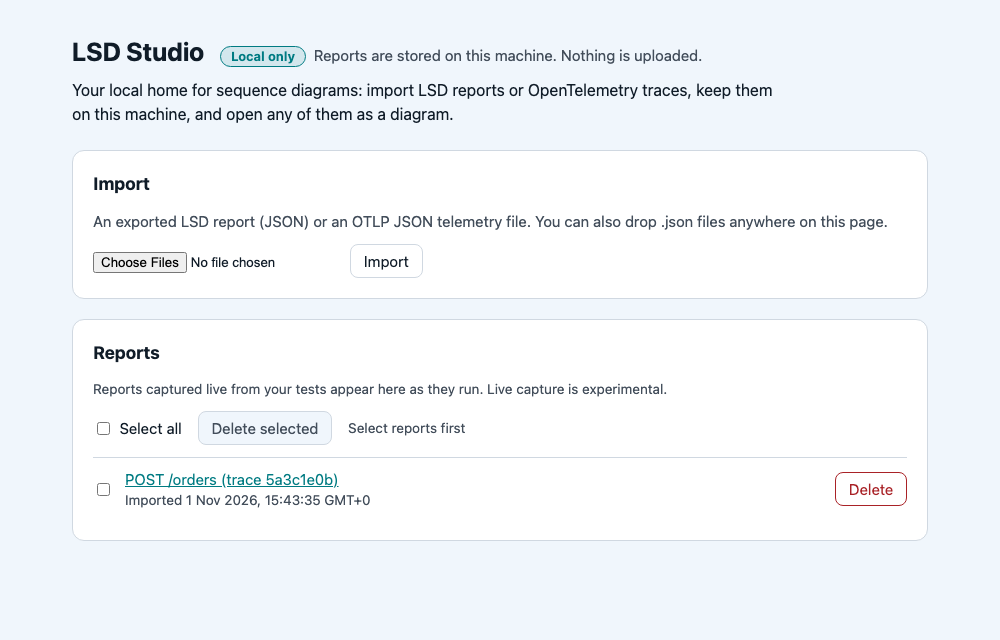

# LSD Studio

LSD Studio runs locally on your machine and turns LSD reports and traces into sequence diagrams.

Part of [LSD: living sequence diagrams](../../README.md). It keeps the reports you give it on this
machine, lists them, and opens any of them in the same interactive report the tests write. Nothing
is uploaded. It is early: work is tracked in [#186](https://github.com/lsd-consulting/lsd-mono/issues/186).



## Start it

LSD Studio is not published yet: the package is private (`0.0.0`), and whether it goes to npm is
still to be decided. Until then, run it from a checkout of this repo, with the Node version in the
repo's `.nvmrc`:

```sh
cd modules/lsd-mono-studio
nvm use
npm install      # once: installs dependencies and builds the report viewer
npm start        # then open http://127.0.0.1:7357
```

`npm start -- --demo` imports a sample trace at startup, so there is something to open straight
away. Without it, an empty list offers **Try a sample**, which does the same.

| Option            | Environment variable       | What                                         |
| ----------------- | -------------------------- | -------------------------------------------- |
| `--port 8080`     | `LSD_STUDIO_PORT=8080`     | Another port (default 7357)                  |
| `--expose`        | `LSD_STUDIO_EXPOSE=1`      | Listen on every interface, not only this one |
| `--demo`          |                            | Import the sample trace at startup, once     |
| `--viewer <file>` | `LSD_STUDIO_VIEWER=<file>` | A report viewer build to try first           |

Reports are kept in `~/.lsd/server/reports`.

## Three ways in

1. **The sample.** **Try a sample** on the empty list, or `--demo`: a small trace of an order placed
   through four services.
2. **A trace from your tracing tool.** Export a trace as OTLP JSON from Jaeger or Tempo, or write
   one with an OpenTelemetry Collector's `file` exporter (the way in for Zipkin, whose own export
   is Zipkin JSON, not OTLP), then choose the files with **Import** or drop
   them on the page. Exported LSD reports (`*-report.json`) import the same way. Several files can
   be imported at once. See [OTLP import](#otlp-import-96) for how spans become a diagram.
3. **Live from your tests (experimental).** Point a JVM test run at LSD Studio and each report
   appears in the list while its tests run, marked "Capturing…", from JUnit, Cucumber or Spring
   Boot alike:

    ```sh
    LSD_MONO_STUDIO_URL=ws://127.0.0.1:7357/ws/captures ./gradlew test
    ```

    or `lsd.mono.studio.url` in `lsd-mono.properties`. The setting, and the
    [protocol](#live-capture-protocol-152) behind it, can change in any release. See
    [Live capture to LSD Studio](../lsd-mono-jvm/README.md#live-capture-to-lsd-studio-experimental).

The list checks for new and growing reports every few seconds. Select a title to open the report;
**Delete** removes one, or tick several and **Delete selected**.

## For contributors

The rest of this page is how LSD Studio is built and what it speaks.

### Options and older names

Each option above also reads an environment variable, and `LSD_STUDIO_SKIP_VIEWER=1` skips the
viewer build at install. The `LSD_SERVER_*` names from before the rename (`LSD_SERVER_PORT`,
`LSD_SERVER_EXPOSE`, `LSD_SERVER_VIEWER`, `LSD_SERVER_SKIP_VIEWER`) still work. When both are set,
`LSD_STUDIO_*` wins.

### The report viewer

Reports open in the report UI's single-file build (`modules/lsd-mono-report-html`). `npm install`
and `npm ci` build it for you: the `prepare` script (`scripts/build-viewer.mjs`) runs `npm ci` and
`npm run build:single` in `modules/lsd-mono-report-html/ui` and copies the result to
`viewer/lsd-report.html`, which is gitignored. It takes a few seconds the first time and is skipped
while the copy is newer than the UI's sources (it copies the UI's own `dist` build instead when that
is up to date). If the build fails, installing still succeeds with a warning, and reports show the
"Report viewer not built" page until `npm run build:viewer` (always rebuilds) succeeds.
`LSD_STUDIO_SKIP_VIEWER=1` (or `LSD_SERVER_SKIP_VIEWER=1`) skips the build, which the studio CI job does since its tests bring
their own viewer.

When opening a report LSD Studio uses the first viewer it finds:

1. The `--viewer <file>` or `LSD_STUDIO_VIEWER` override, for working on the UI: point it at
   `modules/lsd-mono-report-html/ui/dist/lsd-report.html` and rerun `npm run build:single` there.
2. The bundled copy, `viewer/lsd-report.html`.
3. The report UI's build in the checkout, `modules/lsd-mono-report-html/ui/dist/lsd-report.html`.

A file that is not the report viewer is passed over. When the override is missing or is not the
viewer, LSD Studio says so on stderr at startup, naming the path, and falls back to the next one. With none of them, the page says how to build
it.

### Packaging

`npm pack` runs `prepack`. It copies the report schema, builds the viewer (failing if it can't),
and compiles `src` to `dist/` with `tsc -p tsconfig.build.json`, because Node does not strip types
from files under `node_modules`. The `files` list ships `bin/`, `dist/`, `public/`,
`viewer/lsd-report.html`, `schema/lsd-report.schema.json`, `samples/`, `protocol/` and this README, so installing a
packed tarball builds nothing, and its `lsd-mono-studio` command (`bin/lsd-mono-studio.js`) runs
`dist/main.js`. The package stays `"private": true` and unpublished until publishing to npm is
decided.

The report schema is copied from `modules/lsd-mono-report-schema` to `schema/` (gitignored) by
`prepare` and `prepack` (`scripts/copy-schema.mjs`). At runtime the bundled copy is used first,
then the checkout's.

`npm test`, `npm run lint` and `npm run typecheck` are what CI runs.

### What is there

| Path                            | What                                                                                             |
| ------------------------------- | ------------------------------------------------------------------------------------------------ |
| `GET /`                         | The report list: import a file, open, delete one or delete a selection, see below                |
| `GET /reports/<id>`             | Open one stored report in the report UI, see below                                               |
| `GET /health`                   | `ok`                                                                                             |
| `GET /api/reports`              | The report index, newest first: `id`, `title`, `importedAt`, `source`, `size`                    |
| `GET /api/reports/<id>`         | One stored report's JSON                                                                         |
| `POST /api/reports/import`      | Import an LSD report (validated) or an OTLP/JSON trace export (converted), see below             |
| `DELETE /api/reports/<id>`      | Delete one report                                                                                |
| `POST /api/reports/bulk-delete` | Delete several reports: see below                                                                |
| `GET /api/diff`                 | 501 for now: side-by-side diff of two reports                                                    |
| `GET /api/reports/<id>/live`    | A live capture's `{revision, live}`; 404 for other reports                                       |
| `ws://…/ws/captures`            | Live capture in the `lsd-live` protocol, see [Live capture protocol](#live-capture-protocol-152) |

### Import

`POST /api/reports/import` with the file as the body:

| Status | When                                                           | Body                                        |
| ------ | -------------------------------------------------------------- | ------------------------------------------- |
| 201    | A valid LSD report or OTLP export, now stored                  | Its index entry                             |
| 422    | An LSD report that fails validation                            | `{"error": "...", "errors": ["path: why"]}` |
| 422    | A malformed OTLP/JSON export                                   | `{"error": "...", "errors": ["path: why"]}` |
| 500    | An OTLP export whose converted report fails the schema (a bug) | Same shape as 422                           |
| 415    | Neither, including OTLP protobuf                               | A plain-text reason                         |
| 413    | The body is over 50 MiB                                        | A plain-text reason                         |

Validation mirrors what the report UI can open:

- **1.x** reports are checked against the repo's report schema
  (`modules/lsd-mono-report-schema/lsd-report.schema.json`, frozen at 1.0.0 in #181), read in
  place with ajv and formats. The schema accepts newer minors by design. At most 50 errors are
  listed.
- **0.x** reports (major 0, or no `schemaVersion` but a `scenarios` list) predate the schema. The
  report UI upgrades them on read, so they are stored as they are, after a basic check that
  `title` is a string and `scenarios` a list of objects.
- **2.0.0 and later** are refused with 422: the report UI would only say to upgrade lsd-mono.

The schema is the bundled copy in `schema/`, or the checkout's when that is missing, see [Packaging](#packaging).

### Sample trace

The package ships `samples/sample-trace.json`, a small OTLP/JSON trace of a made-up order placed
through four services (storefront, orders, inventory and payments). The empty report list offers
it with **Try a sample**, which fetches it from `GET /samples/sample-trace.json` and imports it
through `POST /api/reports/import` like a chosen file. `--demo` imports it at startup unless a
report with its title converted from OTLP is already stored, so repeated runs keep one copy; after
it is deleted, the next `--demo` run imports it again.

### OTLP import (#96)

A body with `resourceSpans` is read as an OTLP/JSON `ExportTraceServiceRequest`, the file an
OpenTelemetry Collector `file` exporter writes, or a trace exported as OTLP JSON from Jaeger or
Tempo. It is converted to an LSD 1.0 report, checked with the same schema validator as
an imported report, and stored with `"source": "otlp"` in the index. The report itself records
`generator.name` `LSD Studio (OTLP import)`, which the report header shows and which is how a
rebuilt index keeps that source. Reports converted before the rename, with
`lsd-mono-server OTLP import`, are still recognised.

How spans map, using the schema's OTel fields (`trace`, `attributes`, `origin`, `source`,
`startedAt`, `accuracy`):

- **Traces → scenarios.** One scenario per `traceId` (`trace-<traceId>`), earliest first, titled
  after its root span. Facts list the trace id, span and service counts.
- **`service.name` → participants**, with the resource's `service.*` attributes. A server span
  with no client span in the export is called by a **Caller** actor. A client span with no server
  span goes to a remote named by `peer.service`, `server.address` or `db.system` (marked
  `lsd.external`).
- **CLIENT → SERVER** pairs (linked by `parentSpanId`) become a synchronous call and its reply;
  **PRODUCER → CONSUMER** pairs become an asynchronous message. A producer or consumer on its own
  goes through a queue named by `messaging.destination.name`.
- Each message carries `trace` (`traceId`, `spanId`, `parentSpanId`), the span attributes plus
  `lsd.span.kind`, `durationMs`, `startedAt`, `source` (the service whose clock it is),
  `origin: "imported"`, `timing: "measured"` and `pairing: "trace"`. `parentId` nests a call under
  the call that caused it.
- **Errors come from span status.** `STATUS_CODE_ERROR` marks the message (`· error`, `✕` on the
  reply) and fails its scenario, with the status message as the scenario error.
- **Order is structural first, then start time:** a call, then what it caused by start time, then
  its reply. Clock skew between hosts cannot move a reply before its call.

Limits:

- OTLP **protobuf** is not supported: send JSON, or it gets 415.
- Ids must be hex, as OTLP/JSON specifies. Base64 ids (from a protobuf-to-JSON dump) get 422.
- **INTERNAL** and unspecified spans are not drawn; a fact counts them. Their client and server
  children still are, called from the internal span's service.
- Span events, links, `kvlistValue` and `bytesValue` attributes are not mapped.
- Fetching a trace by id from Jaeger or Tempo is not built: export the trace and import the file.

### The report list

`GET /` lists the stored reports, newest first. Each title opens the report. A **Local only** badge
says that reports are stored on this machine and nothing is uploaded.

- **Import** a file with the picker and **Import**. While it runs, the button says "Importing…"
  and is disabled, so a double click imports once. Success is announced politely. A refusal is
  an alert that takes focus: a plain reason, then the first five problems and "and N more".
- **Drop** one or more `.json` files (LSD reports or OTLP JSON) anywhere on the page to import
  them. While files are dragged over it, the page shows a dashed drop zone. They are imported one
  after another through the same import. One file gets the same messages as the picker; several
  get "Imported 2 of 3 files." with a line per file, and an alert listing each refused file with
  its reason and first problem. Files not named `.json` are refused without being sent. The file
  picker is the keyboard way to do the same.
- Each row shows when it was imported (or "Captured" for a live capture), in the report UI's date format plus seconds ("31 Oct 2026,
  21:47:05 GMT"). The time is also in the checkbox, Delete button and dialog wording, so reports
  with the same title can be told apart.
- **Delete** on a row, or tick reports (or **Select all**) and press **Delete selected**, which
  calls `POST /api/reports/bulk-delete`. Nothing goes until you confirm in a dialog that names
  the report, or lists the first five and "and N more". Cancel or Escape keeps everything. While
  nothing is selected, **Delete selected** is disabled and says "Select reports first", which
  screen readers hear as its description.
- After a delete the list reloads and a status line says what went.
- The list checks for changes every 3 seconds while the tab is visible and no dialog is open, and
  at once when the tab is shown again, so a new or growing live capture appears without a reload.
  It redraws only when something changed, and keeps the selection.
- With no reports, the page says so and hides the bulk controls.
- Light and dark follow the system setting, with the report UI's colours.
- Every control is labelled for screen readers. Status lines are live regions, and focus goes back
  to the button you pressed when you cancel.

The page is plain HTML and a script in `public/index.html`, tested in jsdom
(`src/list-page.test.ts`).

### Open a report

Click a report's title in the list, or go to `GET /reports/<id>`. LSD Studio serves the report
UI's single-file build with the report injected, the same way the JVM writer does. An
"All reports" bar above it links back to the list: first in tab order, taking its own space so it
covers nothing, and hidden in print. The tab is titled "<report title> – LSD Studio". 0.x reports
open too: the UI upgrades them on read.

| Status | When                       | Body                           |
| ------ | -------------------------- | ------------------------------ |
| 200    | The report exists          | The report page                |
| 404    | No report with that id     | A page with a link to the list |
| 503    | No report viewer was found | The folder and build command   |

Both pages fit phones and follow the system's light or dark setting.

The viewer comes from `npm install`, see [The report viewer](#the-report-viewer).

### Live capture protocol (#152)

A sender (a test run, a capture filter) opens `ws://127.0.0.1:7357/ws/captures` and streams what it
captures as it happens. The server builds a report from it, stored like an import (source
`capture`), so it shows on the report list and opens like any other report.

**The schema** is [`protocol/lsd-live.schema.json`](protocol/lsd-live.schema.json) (JSON Schema
2020-12). It lives in this module, not in `lsd-mono-report-schema`: that module is published and its
versions are frozen once released, while this protocol is v0 and has one implementation. Captured
events and statuses are not redefined: the protocol refers to the report schema's `DiagramEvent`,
`Participant`, `Status` and `ScenarioError` by `$id`, so a sender sends exactly what a report holds. A
JVM sender's tests in this repo can read the schema and the fixtures from
`modules/lsd-mono-studio/protocol/`. When a second implementation ships, it moves next to the report
schema and is published with it.

**Messages.** Every message is one JSON text frame with a `type`:

| From   | `type`           | Fields                                                                     |
| ------ | ---------------- | -------------------------------------------------------------------------- |
| sender | `hello`          | `protocol: "lsd-live"`, `version`, optional `title`, `sender.name`         |
| sender | `scenario.start` | `scenarioId`, `title`, optional `participants`                             |
| sender | `event`          | `scenarioId`, `event`: one report `DiagramEvent`                           |
| sender | `scenario.end`   | `scenarioId`, `status`, optional `error`                                   |
| sender | `error`          | `message`, optional `scenarioId`: the sender's own trouble, kept as a fact |
| sender | `report.done`    | The capture is complete                                                    |
| server | `welcome`        | `protocol`, `version`, `reportId`, `url` of the report page                |
| server | `error`          | `code`, `message`, optional `errors` (schema paths)                        |
| server | `stored`         | `reportId`, after `report.done`                                            |

**Versioning.** `version` is semver; this server speaks `0.1.0`. The server takes a hello of the
same major at any minor and refuses any other major with `unsupported-version` and close code
`4001`. A minor only adds optional fields or message types, and both sides ignore fields they do
not know, so an older server reads a newer sender. A breaking change is a new major.

**Errors.** The first message must be a valid `hello`; anything else gets an error and close code
`4002`. After the hello, a bad message (`invalid-json`, `invalid-message`, `unknown-scenario`,
`duplicate-scenario`, `scenario-ended`, `duplicate-hello`, `report-done`) gets an error reply and
is otherwise ignored: the capture goes on. `report.done` gets `stored` and close code `1000`.

**The live report.** It is stored at the hello and rewritten after every accepted message. A
report carries each scenario's `measuredRatio` and `pairedRatio`, computed as for OTLP imports, so
the Accuracy card reads them. A running scenario shows as `warn` with the fact "Live: still capturing"; until the first scenario
starts, a placeholder scenario says it is waiting. If the socket closes before `report.done`,
running scenarios become `aborted` ("Capture cut off") and the report is kept.

**Watching it.** An open live report page polls `GET /api/reports/<id>/live` once a second and
reloads when the revision changes, keeping its scroll position; it stops once the capture is done.
The report UI renders a report once, so a reload is the simple, robust update. The report list
shows a new capture within a few seconds.

**Contract fixtures.** [`protocol/fixtures/`](protocol/fixtures) holds message streams, one frame
per line, valid and invalid, and a `manifest.json` with the replies, close code and stored report
each one must produce. This module's tests replay every stream; a sender's tests can check it
produces streams the schema accepts and that match them.

**Replay one** to a running studio, for a demo or to try a sender's output:

```bash
npm run replay -- protocol/fixtures/streams/checkout.jsonl --delay 800
```

`--url` points it elsewhere (default `ws://127.0.0.1:7357/ws/captures`).

**Senders.** `lsd-mono-jvm` streams test runs in this protocol (experimental, see
[Live capture to LSD Studio](../lsd-mono-jvm/README.md#live-capture-to-lsd-studio-experimental)),
and its tests check every frame against this schema and these fixtures.

### Storage

Each report is `<id>.json` in the reports directory, next to an `index.json` that the report list
reads, so listing never opens the reports. Each entry holds the `id`, the report's `title` (or
"Untitled report"), `importedAt` (ISO-8601), `source` (`import`, `otlp` or `capture`) and `size` in
bytes. The index is replaced whole via a temp file and a rename, and writes are queued. A reports
directory without an index gets one rebuilt from its report files.

### Bulk delete

`POST /api/reports/bulk-delete` with `{"ids": ["…", "…"]}` (1 to 1000 ids):

| Status | When                               | Body                                    |
| ------ | ---------------------------------- | --------------------------------------- |
| 200    | Always, even if no id exists       | `{"deleted": [...], "notFound": [...]}` |
| 400    | The body is not JSON of that shape | A plain-text reason                     |

Deletes are idempotent: repeating one succeeds. Duplicate ids count once. `DELETE /api/reports/<id>`
answers 204 whether or not the report existed, and 400 for an id that is not a report id.

### Decisions (#186)

1. **Secure by default.** Binds to `127.0.0.1`. Only `--expose` (or `LSD_STUDIO_EXPOSE=1`) binds every interface.
2. **Import** takes exported LSD report JSON and OTLP JSON telemetry exports. Both land as stored reports.
3. **Storage** is a directory the server owns, hard-coded to `~/.lsd/server/reports` for v1.
4. **No access control** yet. It comes later, after the expose flag.
5. **Cleanup is manual:** delete per report and bulk delete. No maximum count, no auto-expiry.
6. **Real-time captures** use a WebSocket interface defined by its protocol, not by any capture
   library. A Ktor filter pointed at the server is one example of a client. The message shape is
   the `lsd-live` protocol, v0 (#152).
